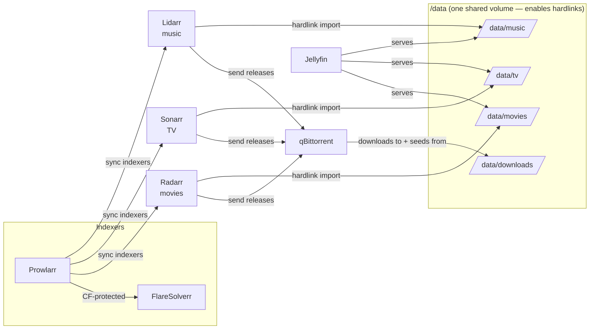

# 🎬 media-stack

A clean, opinionated, **fully open-source** home media stack built on Docker:
automatic movie/TV/music acquisition from your indexers straight into a
Netflix-style frontend — with **hardlink-based imports** so nothing is stored
twice and your torrents keep seeding.

> **Torrent ethics:** this stack runs a **single** torrent client and is designed
> for **long-term seeding** and healthy ratio on private trackers. It does not
> encourage leeching-and-deleting.

---

## Stack at a glance

| Service | Role | Image | Default URL |
|---|---|---|---|
| **qBittorrent** | The one torrent client (downloads + seeds) | `lscr.io/linuxserver/qbittorrent` | http://localhost:8080 |
| **Prowlarr** | Indexer manager — configure trackers once | `lscr.io/linuxserver/prowlarr` | http://localhost:9696 |
| **Radarr** | Movies automation | `lscr.io/linuxserver/radarr` | http://localhost:7878 |
| **Sonarr** | TV automation | `lscr.io/linuxserver/sonarr` | http://localhost:8989 |
| **Lidarr** | Music automation | `lscr.io/linuxserver/lidarr` | http://localhost:8686 |
| **Jellyfin** | Media server / frontend | `lscr.io/linuxserver/jellyfin` | http://localhost:8096 |
| **FlareSolverr** | Cloudflare solver for protected public indexers | `ghcr.io/flaresolverr/flaresolverr` | http://localhost:8191 |

All services share a private Docker bridge network `media-net` and reach each
other by name (e.g. Prowlarr → `http://flaresolverr:8191`). Containers are named
`media-stack-<service>` so `docker ps` reads as one product.

## Repository layout

```
media-stack/
├── docker-compose.yml     # the whole stack
├── .env.example           # copy to .env, fill in
├── README.md
├── config/                # per-service app state (gitignored) ── the "runtime"
│   ├── qbittorrent/  prowlarr/  sonarr/
│   ├── radarr/       lidarr/    jellyfin/
│   └── jackett/           # legacy, superseded by Prowlarr
├── data/                  # downloads + media libraries (gitignored)
│   ├── downloads/  movies/  tv/  music/
├── scripts/               # helper tools (see scripts/README.md)
│   ├── import_letterboxd_to_radarr.py
│   └── watchlists/        # your CSV exports (gitignored)
└── planning/              # internal notes (gitignored)
```

Only the **recipe** (compose, `.env.example`, README, scripts) is tracked in git.
Everything that a running stack regenerates — `config/`, `data/` — is gitignored.

## Architecture



**The flow:** Prowlarr feeds indexers to the *arrs → the *arrs grab releases and
hand them to qBittorrent → qBittorrent downloads into `/data/downloads` and keeps
**seeding** there → the *arrs **hardlink** the finished files into
`/data/movies|tv|music` → Jellyfin serves them. One copy on disk, seeded and
served at the same time.

## Why one `/data` volume? (hardlinks)

Every media service mounts the **same** host folder (`${DATA_ROOT}`, default
`./data`) at the **same** container path `/data`:

```
data/
├── downloads/      # qBittorrent writes + seeds here
│   └── incomplete/
├── movies/         # Radarr library      → Jellyfin
├── tv/             # Sonarr library      → Jellyfin
└── music/          # Lidarr library      → Jellyfin
```

A **hardlink** is a second name for the *same* bytes on disk — but it only works
**within one filesystem**. Because downloads and libraries live under the same
mount, the *arrs import by hardlinking instead of copying:

- ✅ **No doubled storage** — the library entry and the seeding file are one
  physical file.
- ✅ **Instant imports** (no big copy).
- ✅ **Keep seeding** the original path while Jellyfin serves the library path.

> ⚠️ If you split this back into separate `downloads` and `media` mounts,
> hardlinks silently become **copies** — storage doubles and seeding drifts.
> This layout follows the
> [TRaSH Guides folder structure](https://trash-guides.info/File-and-Folder-Structure/).
> Enable **Settings ▸ Media Management ▸ Use Hardlinks instead of Copy** in
> Radarr/Sonarr/Lidarr.

## Quick start

```bash
# 1. Clone
git clone <your-repo-url> && cd <repo>

# 2. Bootstrap — creates the config/ + data/ layout and seeds .env from the example
./scripts/bootstrap.sh

# 3. Edit .env — set PUID/PGID (macOS: 501/20, Linux: usually 1000/1000; `id -u`, `id -g`),
#    TZ, ports, RADARR_API_KEY. Optionally repoint CONFIG_ROOT / DATA_ROOT (e.g. to an HDD).
$EDITOR .env

# 4. Bring it up
docker compose up -d

# 5. Watch it start
docker compose ps
docker compose logs -f qbittorrent
```

<sub>Prefer to do it by hand instead of `bootstrap.sh`? `cp .env.example .env` and
`mkdir -p config data/{downloads,movies,tv,music}` do the same thing.</sub>

> **Moving to a dedicated server / external HDD later?** Set `DATA_ROOT`
> (and `CONFIG_ROOT`) in `.env` — e.g. `DATA_ROOT=/mnt/media/data` — and nothing
> else changes. The in-container paths (`/data`, `/config`) stay fixed, so
> hardlinks keep working. Just keep downloads + libraries on the **same** mount.

Then configure each app in its WebUI (see [Configuration](#configuration)).

**qBittorrent first login:** the LinuxServer image logs a temporary WebUI
password on first start — grab it with `docker compose logs qbittorrent | grep -i password`,
then set your own in the WebUI (Tools ▸ Options ▸ WebUI).

## Configuration

Point every service at the shared `/data` paths — these are the **in-container**
paths, not host paths:

| App | Setting | Value |
|---|---|---|
| qBittorrent | Default Save Path | `/data/downloads` |
| Radarr | Root Folder | `/data/movies` |
| Sonarr | Root Folder | `/data/tv` |
| Lidarr | Root Folder | `/data/music` |
| Jellyfin | Libraries | `/data/movies`, `/data/tv`, `/data/music` |

- In each *arr: **Settings ▸ Download Clients ▸ add qBittorrent** at host
  `qbittorrent`, port `8080`. Use qBittorrent **categories** (`movies`, `tv`,
  `music`) so downloads stay organized.
- In each *arr: **Settings ▸ Media Management ▸ Use Hardlinks instead of Copy** = on.
- **Prowlarr ▸ Settings ▸ Apps:** add Radarr/Sonarr/Lidarr so indexers sync to
  them automatically.
- **Prowlarr ▸ Settings ▸ Indexer Proxies:** add FlareSolverr at
  `http://flaresolverr:8191`, tag it `cf`, and tag Cloudflare-protected indexers
  `cf` so they route through it.

## Scripts

- **`scripts/import_letterboxd_to_radarr.py`** — bulk-import a Letterboxd
  watchlist into Radarr (with `--dry-run`, matching, and an unmatched-items
  report). See **[scripts/README.md](scripts/README.md)**.

## Configuration & data are **not** in git

`.gitignore` excludes `config/` (app databases, API keys), `data/` (your media),
`.env` (secrets), and personal CSVs. Cloning this repo gives you the **recipe**,
not anyone's library or credentials. Back up your `config/` folder separately —
the media is re-downloadable, the configs are not.

## Roadmap

Actively planned in the (gitignored) `planning/` folder — VPN via Gluetun,
Tailscale remote access, CinemaZ as a private indexer, per-category seeding
rules, Recyclarr/TRaSH profiles, Bazarr subtitles, and a move to a dedicated
Linux server + external HDD.

## License & ethics

Open-source tooling only. Use it to manage **content you're entitled to**, and
respect your trackers' rules. You are responsible for what you download.
